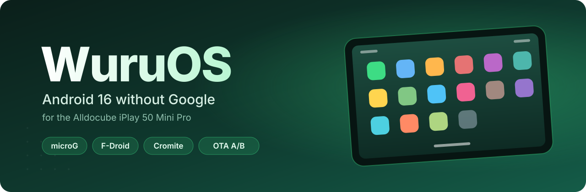

<div align="center">



[Español](README.md) · **English**

[](https://github.com/charlyrr/wuruos/releases/latest)


[](https://github.com/charlyrr/wuruos/releases)

<br>

<a href="https://github.com/charlyrr/wuruos/releases/latest"></a>

</div>

<br>

WuruOS is a personal ROM: a Generic System Image (GSI) built on **AOSP** and the **TrebleDroid** compatibility patches. It follows the CalyxOS philosophy: clean Android, no Google services, free alternatives preinstalled, and signed with its own keys.

This repository only hosts the published releases.

## What's inside

<table>
<tr>
<td width="50%" valign="top">

### 🛡️ No Google
No Google Apps, no Play Services. Time sync (NTP) and the connectivity check don't call Google servers.

</td>
<td width="50%" valign="top">

### 🧩 microG
Compatibility with apps that need Google services: push notifications and network location.

</td>
</tr>
<tr>
<td width="50%" valign="top">

### 📦 F-Droid
With the privileged extension for silent app updates, and the IzzyOnDroid, FUTO and Brave repositories already added.

</td>
<td width="50%" valign="top">

### 🌐 Cromite
Chromium-based browser and WebView, de-Googled and with a built-in ad blocker.

</td>
</tr>
<tr>
<td width="50%" valign="top">

### 🔄 OTA updates
The *Updates* app installs each new release to the other slot (A/B) while you keep using the tablet. The previous release stays on the old slot.

</td>
<td width="50%" valign="top">

### 💾 Seedvault
Encrypted backups of apps and data.

</td>
</tr>
<tr>
<td width="50%" valign="top">

### 🔑 Own signing keys
The whole system is signed with its own keys, and so is the update feed, so the tablet only accepts genuine releases.

</td>
<td width="50%" valign="top">

### ⚡ Tuned for the Helio G99
Precompiled UI, no blur effects the GPU can't keep up with, and pre-forked app processes so apps open faster.

</td>
</tr>
</table>

## Device

Built and tested for the **Alldocube iPlay 50 Mini Pro** (T811M, MediaTek Helio G99, 8 GB, 8.4" 1920×1200 display).

It's an arm64 A/B GSI, so it *might* boot on other Treble devices, but it's only tested on this tablet. Anywhere else, use it at your own risk.

> [!NOTE]
> WuruOS ships in **Spanish** with the Madrid time zone. You can change the language in *Settings → System → Languages*.

## Installation

### Already on WuruOS

Nothing to do. The **Updates** app tells you when a new release is out: tap *Download and install*, then restart when it's done. Your data is kept.

### First install

> [!WARNING]
> Installing WuruOS for the first time **wipes all data** on the tablet, and the bootloader must be unlocked. Back up anything you care about first.

1. Download `wuruos-<version>-arm64-ab-<date>-release.img.xz` from the [latest release](https://github.com/charlyrr/wuruos/releases/latest) and unpack it with `xz -d`.
2. **Only if you're coming from the stock ROM:** in the bootloader (*Fastboot Mode*), disable verification using the `vbmeta.img` from the Alldocube firmware:
   ```bash
   fastboot --disable-verity --disable-verification flash vbmeta vbmeta.img
   ```
3. Boot into **fastbootd**, free up space by deleting `product` (the GSI doesn't use it), and flash the image to `system`:
   ```bash
   fastboot reboot fastboot
   fastboot delete-logical-partition product_a   # or product_b, depending on the active slot
   fastboot flash system wuruos-<version>-arm64-ab-<date>-release.img
   ```
4. Boot into recovery and wipe data (*Factory data reset*). `fastboot -w` doesn't work on this tablet.
5. Reboot. The first boot takes 3 to 5 minutes and goes straight to the home screen.

## Verifying downloads

Each release includes:

| File | Purpose |
|---|---|
| `…-release.img.xz` | Full image, to flash from a computer |
| `…-payload.bin` | A/B update installed by the app on the tablet |
| `update.json` + `update.json.sig` | Update feed and its ECDSA signature |

To check the image, compare the `sha256` in `update.json` with the checksum of your download:

```bash
sha256sum wuruos-*-release.img.xz
```

## Limitations

- **The bootloader stays unlocked.** This tablet can't be relocked with a custom key, so there's no verified boot. Your data is still encrypted with your PIN.
- **Vendor, kernel and firmware are Alldocube's.** WuruOS security patches cover the Android system, not the MediaTek drivers.
- **No Google Play.** Apps come from F-Droid or Aurora Store. Apps that require Play Integrity may not work.

## Releases

All releases and their changelogs are under [Releases](https://github.com/charlyrr/wuruos/releases). Version numbers follow `<Android>.<WuruOS>`: 16.2 is the second WuruOS release on Android 16.

## Thanks to

[AOSP](https://source.android.com) · [TrebleDroid](https://github.com/TrebleDroid) · [ponces/treble_aosp](https://github.com/ponces/treble_aosp) · [microG](https://microg.org) · [F-Droid](https://f-droid.org) · [Cromite](https://github.com/uazo/cromite) · [Seedvault](https://github.com/seedvault-app/seedvault) · [CalyxOS](https://calyxos.org), for the inspiration

<sub>WuruOS is an independent personal project. It is not affiliated with Google, Alldocube, CalyxOS or TrebleDroid. Provided as is, without warranty.</sub>
