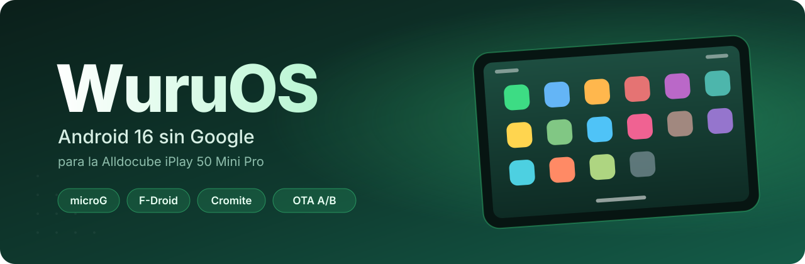

<div align="center">



[](https://github.com/charlyrr/wuruos/releases/latest)


[](https://github.com/charlyrr/wuruos/releases)

<br>

<a href="https://github.com/charlyrr/wuruos/releases/latest"></a>

</div>

<br>

WuruOS es una ROM personal: una imagen genérica de sistema (GSI) basada en **AOSP** y en los parches de compatibilidad de **TrebleDroid**. Sigue la filosofía de CalyxOS: Android limpio, sin servicios de Google, con alternativas libres ya instaladas y firmado con claves propias.

Este repositorio solo aloja las versiones publicadas.

## Qué trae

<table>
<tr>
<td width="50%" valign="top">

### 🛡️ Sin Google
Ni Google Apps ni Play Services. La hora (NTP) y la comprobación de conexión no llaman a servidores de Google.

</td>
<td width="50%" valign="top">

### 🧩 microG
Compatibilidad con las apps que necesitan los servicios de Google: notificaciones push y ubicación por red.

</td>
</tr>
<tr>
<td width="50%" valign="top">

### 📦 F-Droid
Con la extensión privilegiada, que actualiza las apps en silencio, y los repositorios de IzzyOnDroid, FUTO y Brave ya añadidos.

</td>
<td width="50%" valign="top">

### 🌐 Cromite
Navegador y WebView basados en Chromium, sin Google y con bloqueo de anuncios.

</td>
</tr>
<tr>
<td width="50%" valign="top">

### 🔄 Actualizaciones OTA
La app *Actualizaciones* instala cada versión en el otro slot (A/B) mientras sigues usando la tablet. La anterior se queda en el slot de antes.

</td>
<td width="50%" valign="top">

### 💾 Seedvault
Copias de seguridad cifradas de apps y datos.

</td>
</tr>
<tr>
<td width="50%" valign="top">

### 🔑 Firma propia
Todo el sistema va firmado con claves propias, y el aviso de actualización también, así que la tablet solo acepta versiones auténticas.

</td>
<td width="50%" valign="top">

### ⚡ Ajustada al Helio G99
Interfaz precompilada, sin desenfoques que la GPU no aguanta y con procesos precreados para que las apps abran antes.

</td>
</tr>
</table>

## Dispositivo

Hecha y probada para la **Alldocube iPlay 50 Mini Pro** (T811M, MediaTek Helio G99, 8 GB, pantalla de 8,4" a 1920×1200).

Es una GSI arm64 A/B, así que *podría* arrancar en otros dispositivos con Treble, pero solo se prueba en esta tablet. En cualquier otro, úsala bajo tu responsabilidad.

## Instalación

### Ya tienes WuruOS

No tienes que hacer nada. La app **Actualizaciones** avisa cuando hay una versión nueva: pulsas *Descargar e instalar* y reinicias al terminar. Se conservan tus datos.

### Primera instalación

> [!WARNING]
> Instalar WuruOS por primera vez **borra todos los datos** de la tablet, y el bootloader tiene que estar desbloqueado. Haz antes una copia de lo que te importe.

1. Descarga `wuruos-<versión>-arm64-ab-<fecha>-release.img.xz` de la [última versión](https://github.com/charlyrr/wuruos/releases/latest) y descomprímelo con `xz -d`.
2. **Solo si vienes de la ROM de fábrica:** en el bootloader (*Fastboot Mode*), desactiva la verificación con el `vbmeta.img` del firmware de Alldocube:
   ```bash
   fastboot --disable-verity --disable-verification flash vbmeta vbmeta.img
   ```
3. Entra en **fastbootd**, haz sitio quitando `product` (la GSI no lo usa) y flashea la imagen en `system`:
   ```bash
   fastboot reboot fastboot
   fastboot delete-logical-partition product_a   # o product_b, según el slot activo
   fastboot flash system wuruos-<versión>-arm64-ab-<fecha>-release.img
   ```
4. Entra en el recovery y borra los datos (*Factory data reset*). En esta tablet `fastboot -w` no funciona.
5. Reinicia. El primer arranque tarda de 3 a 5 minutos y entra directamente en el escritorio, ya en español.

## Comprobar las descargas

Cada versión trae:

| Archivo | Para qué |
|---|---|
| `…-release.img.xz` | Imagen completa, para flashear desde el PC |
| `…-payload.bin` | Actualización A/B que instala la app desde la tablet |
| `update.json` + `update.json.sig` | Aviso de actualización y su firma ECDSA |

Para comprobar la imagen, compara el `sha256` de `update.json` con la suma de tu descarga:

```bash
sha256sum wuruos-*-release.img.xz
```

## Limitaciones

- **El bootloader queda desbloqueado.** Esta tablet no permite volver a bloquearlo con una clave propia, así que no hay arranque verificado. Tus datos siguen cifrados con tu PIN.
- **El vendor, el kernel y el firmware son los de Alldocube.** Los parches de seguridad de WuruOS cubren el sistema Android, no los drivers de MediaTek.
- **Sin Google Play.** Las apps se instalan desde F-Droid o Aurora Store. Las que exigen Play Integrity pueden no funcionar.

## Versiones

Todas las versiones, con sus novedades, están en [Releases](https://github.com/charlyrr/wuruos/releases). El número sigue el formato `<Android>.<WuruOS>`: la 16.2 es la segunda versión de WuruOS sobre Android 16.

## Gracias a

[AOSP](https://source.android.com) · [TrebleDroid](https://github.com/TrebleDroid) · [ponces/treble_aosp](https://github.com/ponces/treble_aosp) · [microG](https://microg.org) · [F-Droid](https://f-droid.org) · [Cromite](https://github.com/uazo/cromite) · [Seedvault](https://github.com/seedvault-app/seedvault) · [CalyxOS](https://calyxos.org), por la inspiración

<sub>WuruOS es un proyecto personal e independiente. No está afiliado a Google, Alldocube, CalyxOS ni TrebleDroid. Se ofrece tal cual, sin garantías.</sub>
